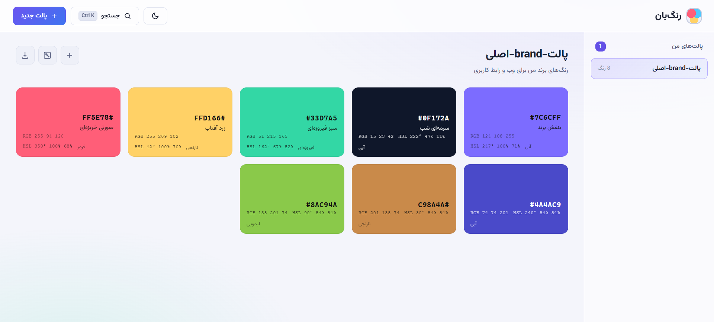

<p align="center">
  🌍 Read in English: <a href="README.md"><b>English</b></a>
</p>

<p align="center">
  
</p>

<h1 align="center">رنگ‌بان 🎨</h1>
<p align="center"><b>مدیریت پالت رنگ برای طراحان و توسعه‌دهندگان</b></p>

<p align="center">
  ساخت، سازماندهی و خروجی گرفتن از پالت‌های رنگی با رابط فارسی
</p>

---

## 📥 نصب و راه‌اندازی

<p align="center">
  <a href="https://github.com/AmirBahadorAmiri/Rangban/archive/refs/heads/main.zip"><b>⬇️ دانلود مستقیم</b></a>
</p>

---

## 🌟 ویژگی‌ها

### 📋 مدیریت پالت
*   ساخت پالت رنگ با نام و توضیح
*   **Drag & drop برای مرتب‌سازی رنگ‌ها**
*   جستجوی سریع پالت و رنگ
*   ستاره‌دار کردن رنگ‌های مهم

### 🎨 کار با رنگ
*   افزودن رنگ با کد HEX یا انتخابگر رنگ
*   روشن‌تر و تیره‌تر کردن رنگ (+۱۰٪ / -۱۰٪)
*   نمایش RGB و HSL به صورت خودکار
*   **پالت تصادفی با ۶ الگوی هماهنگ**

### 💾 خروجی گرفتن
*   **CSS Variables** — برای پروژه‌های وب
*   **SCSS** — برای پروژه‌های Sass
*   **JSON** — برای استفاده در برنامه‌ها
*   **Tailwind** — برای تنظیمات Tailwind CSS
*   **TXT** — لیست ساده کدهای HEX

### 🌙 رابط کاربری
*   تم روشن و تاریک با تشخیص خودکار
*   منوی راست‌کلیک برای عملیات سریع
*   طراحی RTL کامل فارسی

---

## 🛠 تکنولوژی‌ها

*   **زبان:** PHP 8+
*   **دیتابیس:** MySQL / MariaDB
*   **معماری:** MVC ساده (بدون فریمورک)
*   **رابط:** HTML5, CSS3, Vanilla JavaScript
*   **امنیت:** CSRF Protection, PDO Prepared Statements

---

## 🚀 راهنمای نصب

1. پیش‌نیازها را نصب کنید:
   *   XAMPP یا سرور PHP مشابه
   *   MySQL/MariaDB

2. پروژه را کلون کنید:
   ```bash
   git clone https://github.com/your-repo/ColorManager.git
   ```

3. پروژه را در پوشه `htdocs` قرار دهید.

4. تنظیمات دیتابیس را در `config.php` ویرایش کنید:
   ```php
   const DB_HOST = '127.0.0.1';
   const DB_NAME = 'rangban';
   const DB_USER = 'root';
   const DB_PASS = '';
   ```

5. پروژه را در مرورگر باز کنید:
   ```
   http://localhost/ColorManager
   ```

> دیتابیس و جداول به صورت خودکار ساخته می‌شوند.

---

## 📸 تصویر

<p align="center">
  
</p>

---

## 📁 ساختار پروژه

```
ColorManager/
├── index.php          صفحه اصلی
├── config.php         تنظیمات و اتصال دیتابیس
├── export.php         خروجی گرفتن
├── src/
│   ├── api.php        endpoint عملیات AJAX
│   ├── database.php   اتصال PDO و ساخت جداول
│   ├── repository.php عملیات CRUD
│   ├── helpers.php    توابع کمکی
│   └── color_tools.php تبدیل رنگ و scheme
├── assets/
│   ├── style.css      استایل
│   └── app.js         منطق فرانت‌اند
└── db/
    └── seed.php       داده نمونه
```

---

## 🔌 API Endpoint

همه درخواست‌ها به `src/api.php` با متد POST و CSRF token.

| Action | توضیح | پارامترها |
|--------|-------|-----------|
| `palette_create` | ساخت پالت | name, description |
| `palette_update` | ویرایش پالت | id, name, description |
| `palette_delete` | حذف پالت | id |
| `color_add` | افزودن رنگ | palette_id, hex, name |
| `color_update` | ویرایش رنگ | id, hex, name |
| `color_delete` | حذف رنگ | id |
| `color_favorite` | ستاره‌دار کردن | id |
| `color_reorder` | مرتب‌سازی | palette_id, ids[] |
| `color_shade` | روشن/تیره | id, percent |
| `palette_random` | پالت تصادفی | id, replace |

---

## 👨‍💻 توسعه‌دهنده

توسعه داده شده توسط **تیم رنگ‌بان**

> [!TIP]
> برای داده نمونه، فایل `db/seed.php` را در مرورگر اجرا کنید.

---

## 📄 لایسنس

این پروژه تحت لایسنس **MIT** منتشر شده است.
