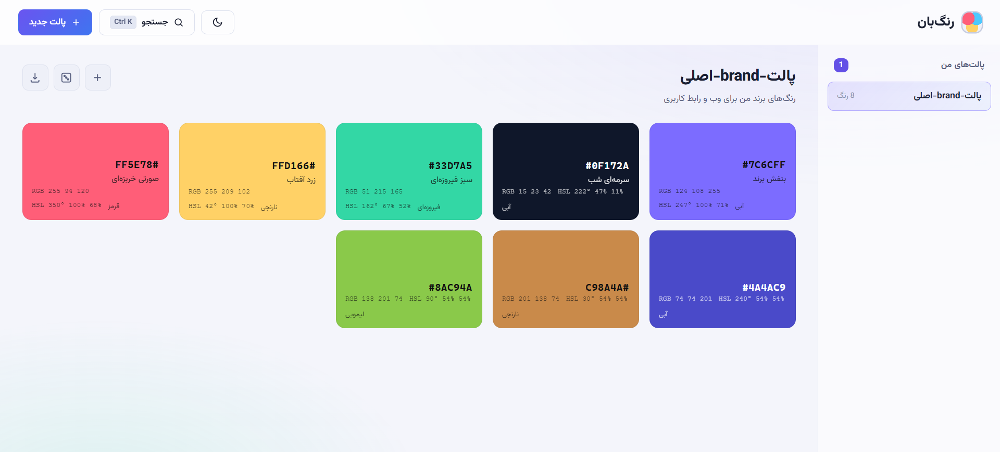

<p align="center">
  📄 Read in Persian: <a href="README.fa.md"><b>فارسی</b></a>
</p>

<p align="center">
  
</p>

<h1 align="center">Rangban 🎨</h1>
<p align="center"><b>Color Palette Manager for Designers & Developers</b></p>

<p align="center">
  Create, organize, and export color palettes with a Persian interface
</p>

---

## 📥 Download & Install

<p align="center">
  <a href="https://github.com/AmirBahadorAmiri/Rangban/archive/refs/heads/main.zip"><b>⬇️ Direct Download</b></a>
</p>

---

## 🌟 Key Features

### 📋 Palette Management
*   Create color palettes with name and description
*   **Drag & drop to reorder colors**
*   Quick search for palettes and colors
*   Star important colors for quick access

### 🎨 Color Tools
*   Add colors via HEX code or color picker
*   Lighten and darken colors (+10% / -10%)
*   Automatic RGB and HSL display
*   **Random palette with 6 harmony schemes**

### 💾 Export Options
*   **CSS Variables** — for web projects
*   **SCSS** — for Sass projects
*   **JSON** — for programmatic use
*   **Tailwind** — for Tailwind CSS config
*   **TXT** — simple HEX list
*   **JSON backup** — export one palette or all palettes and import them back later

### 🌙 User Interface
*   Light and dark themes with auto-detection
*   Right-click context menu for quick actions
*   Full RTL Persian interface

---

## 🛠 Technologies Used

*   **Language:** PHP 8+
*   **Database:** MySQL / MariaDB
*   **Architecture:** Simple MVC (no framework)
*   **Frontend:** HTML5, CSS3, Vanilla JavaScript
*   **Security:** CSRF Protection, PDO Prepared Statements

---

## 🚀 Installation & Run Guide

1. Install prerequisites:
   *   XAMPP or similar PHP server
   *   MySQL/MariaDB

2. Clone the project:
   ```bash
   git clone https://github.com/your-repo/ColorManager.git
   ```

3. Place the project in your `htdocs` folder.

4. Configure database in `config.php`:
   ```php
   const DB_HOST = '127.0.0.1';
   const DB_NAME = 'rangban';
   const DB_USER = 'root';
   const DB_PASS = '';
   ```

5. Open in browser:
   ```
   http://localhost/ColorManager
   ```

> Database and tables are created automatically.

---

## 🔄 JSON Import & Export

*   **Export a single palette:** open the palette → export menu → **JSON**
*   **Export all palettes:** export menu → **JSON — All palettes**
*   **Import:** header → **Import JSON**, then pick a `.json` file
*   Importing always **creates new palettes** and never overwrites existing data. Palette names, descriptions, colors, and starred colors are restored.
*   Both single-palette and all-palettes files are accepted. Invalid colors are skipped and reported in the result message.

---

## 📸 Screenshot

<p align="center">
  
</p>

---

## 📁 Project Structure

```
ColorManager/
├── index.php          Main page
├── config.php         Config and database connection
├── export.php         Export functionality
├── src/
│   ├── api.php        AJAX operations endpoint
│   ├── database.php   PDO connection and schema
│   ├── repository.php CRUD operations
│   ├── helpers.php    Helper functions
│   ├── color_tools.php Color conversion and schemes
│   └── transfer.php   JSON export/import helpers
├── assets/
│   ├── style.css      Styles
│   └── app.js         Frontend logic
└── db/
    └── seed.php       Sample data
```

---

## 🔌 API Endpoint

All requests go to `src/api.php` via POST with CSRF token.

| Action | Description | Parameters |
|--------|-------------|------------|
| `palette_create` | Create palette | name, description |
| `palette_update` | Update palette | id, name, description |
| `palette_delete` | Delete palette | id |
| `color_add` | Add color | palette_id, hex, name |
| `color_update` | Update color | id, hex, name |
| `color_delete` | Delete color | id |
| `color_favorite` | Toggle star | id |
| `color_reorder` | Reorder colors | palette_id, ids[] |
| `color_shade` | Lighten/darken | id, percent |
| `palette_random` | Random palette | id, replace |
| `palette_import` | Import palettes from JSON | data (JSON string) |

---

## 👨‍💻 Developer

Developed by **Rangban Team**

> [!TIP]
> For sample data, run `db/seed.php` in your browser.

---

## 📄 License

This project is released under the **MIT** License.
